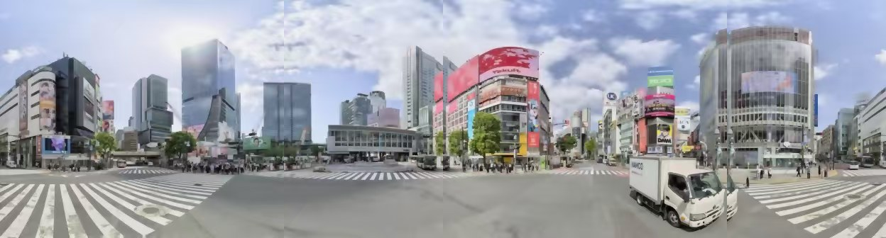
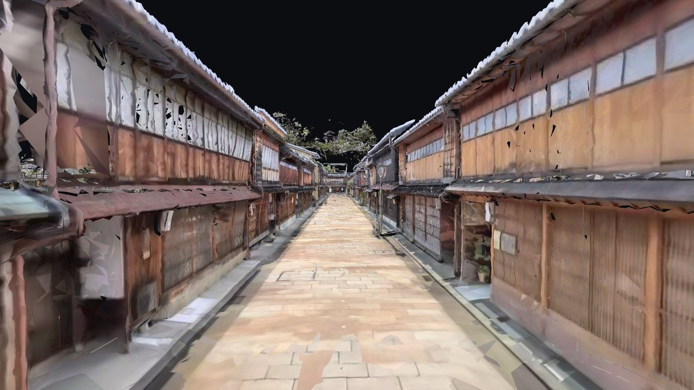
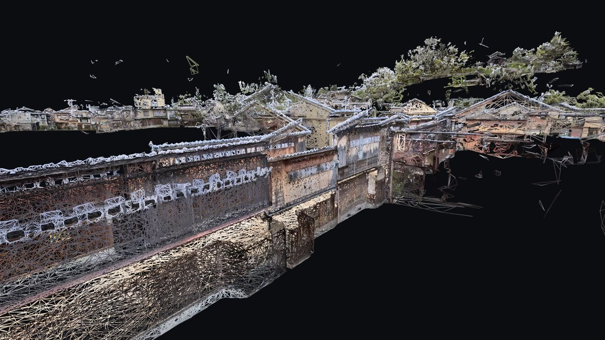
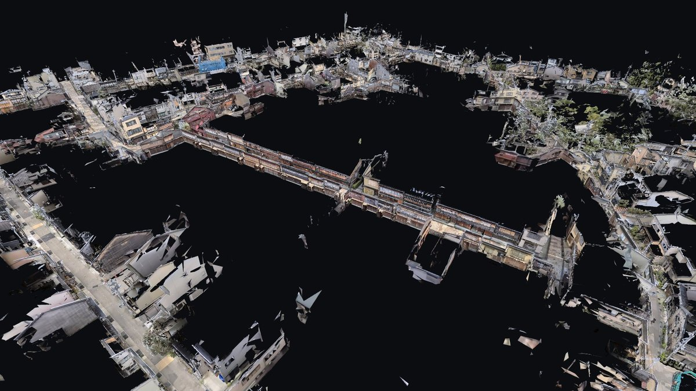
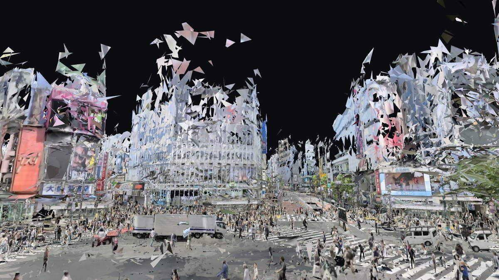

# lookaround-mesh

[English](#english) · [日本語](#状況)

Apple Look Around のパノラマごとに配信されている 3D メッシュ（`mt/7` ファイル）の解読記録とコード。
Decoding notes and code for the 3D meshes (`mt/7` files) that Apple Look Around serves with each panorama.


*Look Around のパノラマ（渋谷スクランブル交差点）。mt/7 に入っている面の画像のうち、経度の帯 4 枚を横に並べたもの。 / A Look Around panorama at the Shibuya scramble crossing: the four longitude strips of face images stored in the mt/7 file, side by side.*

| | |
|---|---|
|  |  |
| 金沢・ひがし茶屋街。993 枚のパノラマのメッシュに面の画像を貼ったもの（通りの目線） / Higashi Chaya, Kanazawa: meshes of 993 panoramas, textured with their face images (street level) | 同じメッシュの三角形の辺 / The same mesh with its triangle edges |
|  |  |
| 上から見たひがし茶屋街 / Higashi Chaya from above | 渋谷（2,050 枚）。奥行きは整数で刻まれていて、遠いビルの上部は破片状になる / Shibuya (2,050 panoramas). Depth is stored as an integer, so the upper floors of distant buildings break into shards |

Look Around のパノラマには、6 つの面（経度で 4 つに切った帯と、上下の帽子）それぞれについて小さなメッシュが付いている。形式は非公開で、Look Around を解析してきた [sk-zk/lookaround](https://github.com/sk-zk/lookaround) でも「容器を区画に切り分けるところまで、区画の中身のパーサはまだ無い」とされていた。ここでは頂点の座標まで、全層を解いた。

## 状況

| 層 | 状態 | 裏付け |
|---|---|---|
| 容器 `MCP4`（記録の表） | ✅ 解読 | 8/8 のファイルで記録がすき間なく全体を覆う |
| 圧縮（LZFSE） | ✅ 解読 | 48/48 のメッシュが宣言どおりの大きさに展開 |
| 小区画 `CHNK` の並び | ✅ 解読 | 種類 0・4・5・9・10・11 |
| 位置の行列（局所 → 地心座標 ECEF） | ✅ 解読 | 回転が正規直交、パノラマ間の距離が GPS と 0.2 m 以内（8/8） |
| 接続情報（Edgebreaker の CLERS 文字列） | ✅ 解読 | 48/48 で三角形数・頂点数一致、向きの一貫した円盤状メッシュに復元 |
| 頂点の残差の詰め方（1 バイト＋例外表） | ✅ 解読 | 48/48 で例外表の長さが 0xff の数と一致 |
| 頂点の並び（軸ごと、Apple の頂点番号順） | ✅ 解読 | 最初の三角形の 3 頂点（生の値）の位置を 48/48 で当てる |
| 座標の組み立て（面の走査＋平行四辺形予測） | ✅ 解読 | 48/48 で全頂点が面の範囲に収まり、範囲が 8 枚で共通 |
| 座標の意味（経度・緯度・距離の逆数） | ✅ 解読 | 地面が平面でカメラ高 2.30〜2.32 m（8/8）。翌日の別走行のメッシュと地心座標で重なる（中央値 0.25 m、対照 4.5 m） |

つまり、各メッシュの三角形と頂点の地心座標（ECEF）がすべて得られる。

形式の詳細は [docs/FORMAT.md](docs/FORMAT.md)。

## 使い方

```bash
pip install -r requirements.txt
python scripts/check.py            # 解けている層の主張をすべて samples/ で検証
python -m pytest tests -q
python scripts/fetch_samples.py    # samples/ を取り直す（Apple のサーバーから）
```

`scripts/check.py` の出力例（すべて OK になる）:

```
OK MCP4: 記録がファイルをすき間なく覆う                       8/8
OK 最初のループの長さ（文字列から計算）= V - Cの数          48/48
OK 復元: どの辺も 2 枚以下、向きが一貫                      48/48
OK 頂点: 例外表の長さ = 本体の 0xff の数                    48/48
OK 位置: パノラマ間の距離が GPS と 0.2 m 以内                8/8
...
```

コードから使う:

```python
import lookaround_mesh as lm

b = open("samples/pano0_mt7.bin", "rb").read()
for raw in lm.meshes(b):                 # 立方体の 6 面
    mat, nv, nf = lm.header(raw)         # 局所→ECEF の 4x4 行列、頂点数、三角形数
    s, boundary = lm.clers(raw)          # CLERS 文字列と境界の頂点数
    tris, gates, _ = lm.decode(s, boundary)   # 三角形（頂点番号の組）
    P = lm.decode_vertices(raw, tris, boundary)  # (V, 3): 経度・緯度 [mrad]、距離の逆数 w
    xyz = lm.to_ecef(raw, P)             # 地心座標 [m]（空の頂点 w = 0 は inf）
    # まとめて: tris, P = lm.face_mesh(raw)
```

OBJ に書き出す（パノラマの位置を原点にした東・北・上）:

```bash
python scripts/export_obj.py samples/pano0_mt7.bin pano0.obj --max-edge 3
```

色付きの点群（PLY）に書き出す。三角形の面に点をまき、面の画像から色を引き、複数のパノラマを 1 つにまとめる:

```bash
python scripts/export_ply.py samples/pano*_mt7.bin cloud.ply --spacing 0.1 --max-range 40
```

ほかの場所のパノラマを取ってきて、点群にし、ブラウザで見る:

```bash
python scripts/fetch_area.py 36.5722 136.6680 --radius 250 --out out/kanazawa
python scripts/export_ply.py out/kanazawa out/kanazawa.ply --spacing 0.1 --max-range 15 --jobs 12
python scripts/export_web.py out/kanazawa.ply out/web
python scripts/serve_web.py out/web 8000        # ブラウザで http://localhost:8000
```

メッシュのまま、面の画像を貼ってブラウザで見る:

```bash
python scripts/export_web_mesh.py out/kanazawa out/web_mesh --jobs 12
python scripts/serve_web.py out/web_mesh 8000
```

場所ごとに、それをいちばん正確に写すパノラマ（面上の 1 画素の大きさと奥行きの刻みで比べる）のメッシュだけを使う。

渋谷のように撮影の多い場所では、年をそろえて間引いてから取る（建て替えが多く、年をまたぐと建物が食い違う）。ビルが高いので距離の上限を広げる:

```bash
python scripts/fetch_area.py 35.6595 139.7005 --radius 250 --date 2026 --min-spacing 3 --out out/shibuya
python scripts/export_web_mesh.py out/shibuya out/web_shibuya --jobs 10 --max-range 50 --min-facing 0.15 --sky-range 30 --max-edge 4
```

奥行き（距離の逆数 w）は整数なので、距離 r での刻みは約 r² / 1000 m（50 m 先で 2.5 m）。高いビルの上部は粗く、破片のようになる。

パノラマから、ふつうのカメラで撮ったような画像を切り出す（方位・仰角・縦の画角を度で指定。`--zoom` で高解像度の面画像を取って使う）。メッシュの描画と同じ視点で並べると、写真とメッシュが 1 画素の精度で重なる:

```bash
python scripts/pano_view.py out/kanazawa/<id>_mt7.bin view.jpg --yaw 104 --pitch 0 --fov 60 --zoom 2
```

点群を学習なしで 3D Gaussian Splatting の形にする（面に沿った平たいガウス。Inria 形式の PLY なので SuperSplat などでも開ける）:

```bash
python scripts/export_splat.py out/street_crop.ply out/splat_street
python scripts/serve_web.py out/splat_street 8000
```

## 構成

```
lookaround_mesh/    解けている層のライブラリ
  container.py      MCP4、LZFSE、CHNK、行列と頂点数
  edgebreaker.py    CLERS 文字列から三角形を復元
  vertices.py       頂点の値、頂点番号、座標の組み立て、ECEF への変換
  fetch.py          mt/7 の取得
scripts/check.py    すべての主張の検証
scripts/fetch_samples.py
scripts/export_obj.py    OBJ に書き出す
scripts/export_ply.py    色付きの点群を PLY に書き出す
scripts/fetch_area.py    ある地点のまわりの mt/7 をまとめて取る
scripts/export_web.py    点群をブラウザ用（three.js）に変換する
scripts/export_web_mesh.py  メッシュを画像付きでブラウザ用に変換する
scripts/export_splat.py  点群を学習なしで 3DGS の形にする
scripts/pano_view.py     パノラマからふつうのカメラの画像を切り出す
scripts/serve_web.py     その出力を手元で配る
experiments/        座標復元の探索で使った初期のスクリプト（docs/HYPOTHESES.md）
samples/            渋谷スクランブル交差点のパノラマ 8 枚の mt/7（下記の注意）
docs/
```

## サンプル

渋谷スクランブル交差点（35.6595, 139.7005）の Look Around パノラマ 8 枚:

- 中心（id 14755389547370281509、2026-04-21 の車載撮影）と、同じ走行で 4.5 m 間隔の 5 枚
- 翌日（2026-04-22）の別走行で、中心から 1.7 m と 3.3 m の 2 枚

別走行の 2 枚は同じ建物を別の位置から見ているので、座標の解読が正しければ、両者のメッシュは地心座標で重なるはず。これを座標復元の判定基準にし、満たした（docs/FORMAT.md の「検証」）。

## 注意: データの扱い

`samples/` の `.bin` と `docs/images/` の画像（Look Around のデータから作ったもの）は Apple の著作物で、このレポジトリのライセンスの対象外（[samples/NOTICE.md](samples/NOTICE.md)）。このレポジトリは非公開を前提にしている。**公開に切り替えるなら、先に `samples/` の `.bin` と `docs/images/` の画像を履歴ごと取り除くこと。** Apple Maps のデータをこの形で取り出すことは Apple の利用規約に抵触しうる。

## 先行研究

- [sk-zk/streetlevel](https://github.com/sk-zk/streetlevel) — Look Around の取得と認証。`fetch.py` はその `Authenticator` を使う。
- [sk-zk/lookaround](https://github.com/sk-zk/lookaround) — `mt/7` の取得と MCP4 の区画分け。
- [retroplasma/flyover-reverse-engineering](https://github.com/retroplasma/flyover-reverse-engineering) — Apple Flyover の C3M 形式の Edgebreaker 変種。頂点番号の振り方と面の走査は同じ系統で、座標の組み立てを解く手がかりになった。

## ライセンス

コードは MIT（[LICENSE](LICENSE)）。`samples/` のデータと `docs/images/` の画像は含まない。

---

## English

### Status

Every layer of the format is decoded, down to vertex coordinates. Look Around panoramas carry one small mesh per face (the panorama is split into four longitude strips plus top and bottom caps). The format is undocumented; [sk-zk/lookaround](https://github.com/sk-zk/lookaround) splits the container into chunks but had no parser for their contents.

| Layer | State | Evidence |
|---|---|---|
| Container `MCP4` (record table) | ✅ decoded | Records tile the whole file without gaps (8/8 files) |
| Compression (LZFSE) | ✅ decoded | 48/48 meshes inflate to their declared size |
| `CHNK` sub-chunks | ✅ decoded | Types 0, 4, 5, 9, 10, 11 |
| Placement matrix (local → Earth-centred ECEF) | ✅ decoded | Rotation is orthonormal; distances between panoramas agree with GPS within 0.2 m (8/8) |
| Connectivity (Edgebreaker CLERS string) | ✅ decoded | Triangle and vertex counts match (48/48); rebuilds consistently oriented disc-shaped meshes |
| Residual packing (1 byte + escape table) | ✅ decoded | Escape table length equals the number of 0xff bytes (48/48) |
| Vertex order (per axis, in Apple's vertex numbering) | ✅ decoded | Predicts the raw values of the first triangle's three vertices (48/48) |
| Coordinate reconstruction (face traversal + parallelogram prediction) | ✅ decoded | All vertices fall inside the face's range, and the ranges agree across all 8 panoramas (48/48) |
| Coordinate meaning (longitude, latitude, inverse distance) | ✅ decoded | The ground is flat with a camera height of 2.30–2.32 m (8/8); meshes from a different drive on the next day overlap in ECEF (median 0.25 m, control 4.5 m) |

So every mesh yields its triangles and the ECEF coordinates of its vertices. Format details (in Japanese): [docs/FORMAT.md](docs/FORMAT.md).

In short, a vertex is (u, v, w): u is longitude and v is latitude in milliradians (v grows downwards), and w is inverse distance, so the distance is r = 1000 / w metres (w = 0 is the sky). w is an integer, so the depth step at distance r is about r² / 1000 m (0.4 m at 20 m, 2.5 m at 50 m). Each face image covers exactly the angular range of its mesh, so (u, v) maps straight to image pixels.

### Usage

```bash
pip install -r requirements.txt
python scripts/check.py            # verify every claim above against samples/
python -m pytest tests -q
python scripts/fetch_samples.py    # re-fetch samples/ from Apple's servers
```

From code:

```python
import lookaround_mesh as lm

b = open("samples/pano0_mt7.bin", "rb").read()
for raw in lm.meshes(b):                 # the six faces
    mat, nv, nf = lm.header(raw)         # local→ECEF 4x4 matrix, vertex count, triangle count
    s, boundary = lm.clers(raw)          # CLERS string and boundary vertex count
    tris, gates, _ = lm.decode(s, boundary)   # triangles (vertex index triples)
    P = lm.decode_vertices(raw, tris, boundary)  # (V, 3): longitude, latitude [mrad], inverse distance w
    xyz = lm.to_ecef(raw, P)             # ECEF [m] (sky vertices with w = 0 become inf)
    # all at once: tris, P = lm.face_mesh(raw)
```

Export to OBJ (east/north/up, with the panorama at the origin):

```bash
python scripts/export_obj.py samples/pano0_mt7.bin pano0.obj --max-edge 3
```

Export a coloured point cloud (PLY): points are scattered over the triangles, coloured from the face images, and several panoramas are merged:

```bash
python scripts/export_ply.py samples/pano*_mt7.bin cloud.ply --spacing 0.1 --max-range 40
```

Fetch panoramas around another place, turn them into a point cloud, and view it in the browser:

```bash
python scripts/fetch_area.py 36.5722 136.6680 --radius 250 --out out/kanazawa
python scripts/export_ply.py out/kanazawa out/kanazawa.ply --spacing 0.1 --max-range 15 --jobs 12
python scripts/export_web.py out/kanazawa.ply out/web
python scripts/serve_web.py out/web 8000        # open http://localhost:8000
```

View the textured meshes in the browser (the pictures above). For each spot, only the mesh of the panorama that captures it most accurately is kept (judged by the size of one image pixel on the surface combined with the depth step):

```bash
python scripts/export_web_mesh.py out/kanazawa out/web_mesh --jobs 12
python scripts/serve_web.py out/web_mesh 8000
```

In heavily captured places such as Shibuya, keep one year and thin the panoramas out before fetching (buildings change often, so mixing years makes them disagree), and allow a longer range for the tall buildings:

```bash
python scripts/fetch_area.py 35.6595 139.7005 --radius 250 --date 2026 --min-spacing 3 --out out/shibuya
python scripts/export_web_mesh.py out/shibuya out/web_shibuya --jobs 10 --max-range 50 --min-facing 0.15 --sky-range 30 --max-edge 4
```

Cut an ordinary camera view out of a panorama (heading, pitch and vertical field of view in degrees; `--zoom` fetches and uses the high-resolution face images). Rendered from the same viewpoint, the mesh lines up with the photo to the pixel:

```bash
python scripts/pano_view.py out/kanazawa/<id>_mt7.bin view.jpg --yaw 104 --pitch 0 --fov 60 --zoom 2
```

Turn a point cloud into 3D Gaussian Splatting without training (flat Gaussians aligned with the surface; an Inria-format PLY that SuperSplat and similar viewers can open):

```bash
python scripts/export_splat.py out/street_crop.ply out/splat_street
python scripts/serve_web.py out/splat_street 8000
```

### Layout

```
lookaround_mesh/    library for the decoded layers
  container.py      MCP4, LZFSE, CHNK, matrix and counts
  edgebreaker.py    triangles from the CLERS string
  vertices.py       vertex values, vertex numbering, coordinate reconstruction, ECEF
  fetch.py          fetching mt/7
scripts/check.py    verification of every claim
scripts/fetch_samples.py
scripts/export_obj.py       export to OBJ
scripts/export_ply.py       export a coloured point cloud to PLY
scripts/fetch_area.py       fetch the mt/7 files around a place
scripts/export_web.py       point cloud for the browser (three.js)
scripts/export_web_mesh.py  textured meshes for the browser
scripts/export_splat.py     point cloud to 3DGS without training
scripts/pano_view.py        ordinary camera views cut out of a panorama
scripts/serve_web.py        serve those outputs locally
experiments/        early scripts from the search for the coordinate layer (docs/HYPOTHESES.md)
samples/            mt/7 files of 8 panoramas at the Shibuya scramble crossing (see the notice below)
docs/
```

### Samples

Eight Look Around panoramas at the Shibuya scramble crossing (35.6595, 139.7005):

- the centre one (id 14755389547370281509, a car capture on 2026-04-21) and five more from the same drive, 4.5 m apart
- two from a different drive on the next day (2026-04-22), 1.7 m and 3.3 m from the centre

The two from the other drive see the same buildings from other positions, so if the coordinates are decoded correctly their meshes must overlap in ECEF. That was the acceptance test for the coordinate layer, and it passes (docs/FORMAT.md, section 検証).

### Notice: data

The `.bin` files in `samples/` and the pictures in `docs/images/` (made from Look Around data) are Apple's copyrighted material and are not covered by this repository's licence ([samples/NOTICE.md](samples/NOTICE.md)). This repository is meant to stay private. **Before making it public, remove the `.bin` files in `samples/` and the pictures in `docs/images/` from the whole history.** Extracting Apple Maps data this way may violate Apple's terms of service.

### Prior work

- [sk-zk/streetlevel](https://github.com/sk-zk/streetlevel) — fetching and authentication for Look Around. `fetch.py` uses its `Authenticator`.
- [sk-zk/lookaround](https://github.com/sk-zk/lookaround) — fetching `mt/7` and splitting MCP4 into chunks.
- [retroplasma/flyover-reverse-engineering](https://github.com/retroplasma/flyover-reverse-engineering) — the Edgebreaker variant in Apple Flyover's C3M format. Its vertex numbering and face traversal belong to the same family and were the key to reconstructing the coordinates.

### Licence

Code: MIT ([LICENSE](LICENSE)). The data in `samples/` and the pictures in `docs/images/` are not included.
